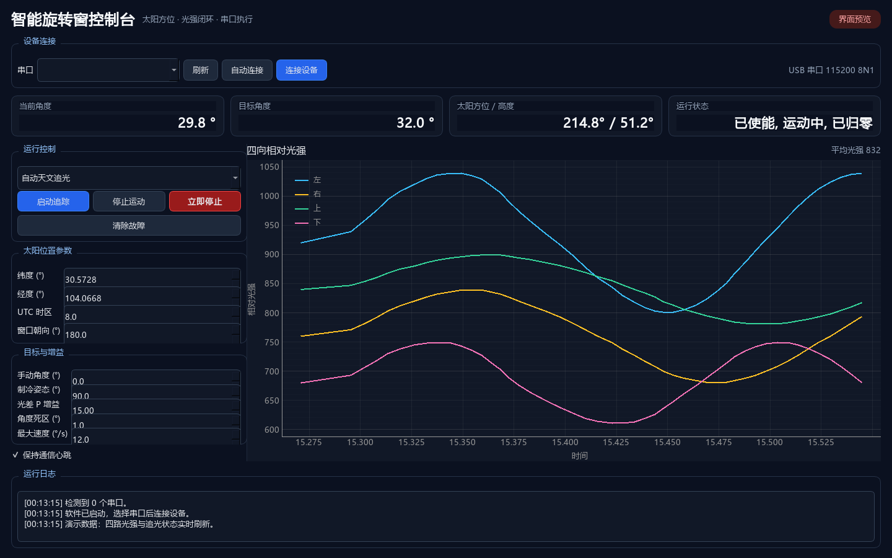

# PC Application Operating Guide

## 1. Start

1. Connect the ESP32 with a USB data cable, not a charge-only cable.
2. Power the 24 V motor supply after the limit switches and emergency stop are
   connected.
3. Start `SmartWindowController.exe`.
4. Click `刷新` if the controller appeared after the program started.
5. Select the CH340/ESP32 port and click `连接设备`.

The connection badge changes color after the firmware handshake. A port that
opens but never returns `SWC1` is not treated as ready.

## 2. Configure solar tracking

Set:

- Latitude and longitude.
- UTC offset, for example `8` for China Standard Time.
- Window outward normal azimuth, where north is `0°` and east is `90°`.

The application calculates solar elevation and azimuth locally. When the sun
is below the horizon, the solar target falls back to the stow angle.

## 3. Modes

| Mode | Behavior |
|---|---|
| Automatic solar tracking | Solar angle plus bounded normalized light PID correction |
| Illuminance harvesting | Moves in the brighter left/right direction |
| Radiative-cooling posture | Moves to the configured cooling angle |
| Manual angle | Uses the angle entered by the operator |

The light PID uses a normalized left/right imbalance, bounded integral and
PWM-like angle correction. The target slew rate limits abrupt movement. The
angle deadband prevents continuous small corrections.

## 4. Start and stop

`启动追踪` sends the mode, current target and start command. The ESP32 first
homes to the minimum limit. Keep the mechanism area clear during this step.

`停止运动` stops pulse generation. `立即停止` sends the same stop command from
the prominent red button. Neither replaces the physical emergency stop.

## 5. Fault handling

| Display | Meaning | Action |
|---|---|---|
| `通信超时` | PC heartbeat stopped | Check USB cable and reconnect |
| `急停` | Physical emergency input active | Release the hardware switch and inspect |
| `上下限位` | Limit input triggered | Move away manually or reset after inspection |
| `传感器故障` | One or more TSL2561 sensors unavailable | Check mux channel and I2C wiring |
| `电机故障` | Driver diagnostic or homing timeout | Check motor current, TMC2209 and mechanism |

After the physical cause is removed, click `清除故障` and start again. Keep
the emergency stop accessible during every test.

## 6. Data display

The four curves show relative light intensity. The average is an uncalibrated
operating indicator, not a photometric measurement. The status area shows the
firmware status bits translated into operator-facing labels.
